
<a href="https://github.com/Kmila9s/.github/blob/main/profile/README.md">English</a>

<picture>
  <source media="(prefers-color-scheme: dark)" srcset="https://github.com/Kmila9s/.github/raw/main/assets/banner-es-dark.svg">
  <source media="(prefers-color-scheme: light)" srcset="https://github.com/Kmila9s/.github/raw/main/assets/banner-es-light.svg">
  
</picture>

   
  

**Kmila** es un laboratorio libre para aprender y depurar lenguajes de descripción de hardware sin FPGA: escribe VHDL, simúlalo y mira formas de onda, el esquemático sintetizado, la repetición paso a paso y un tablero interactivo, además de lecciones y prácticas autocalificadas. Su simulador se compara caso por caso contra GHDL.

<h3 align="center">Empieza aquí</h3>

&nbsp;&nbsp;

<table><tr><td align="center">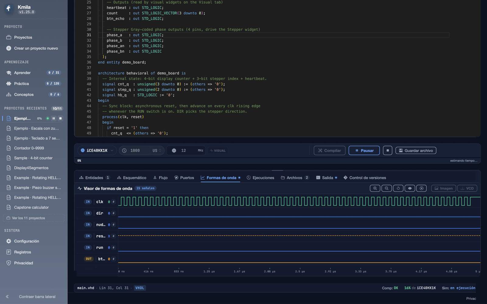 Editor y formas de onda</td><td align="center">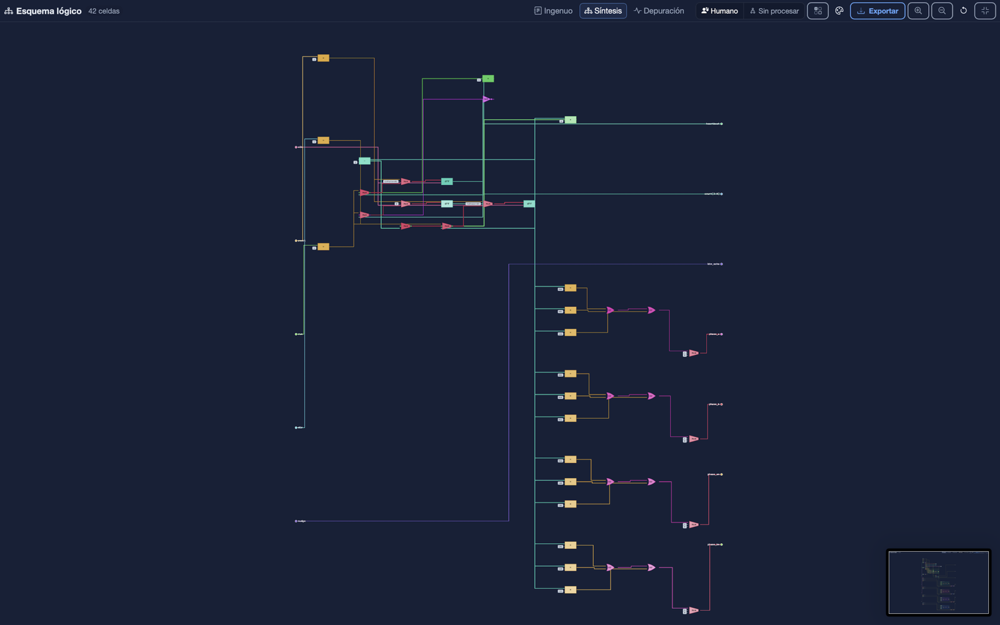 Esquemático sintetizado</td></tr><tr><td align="center">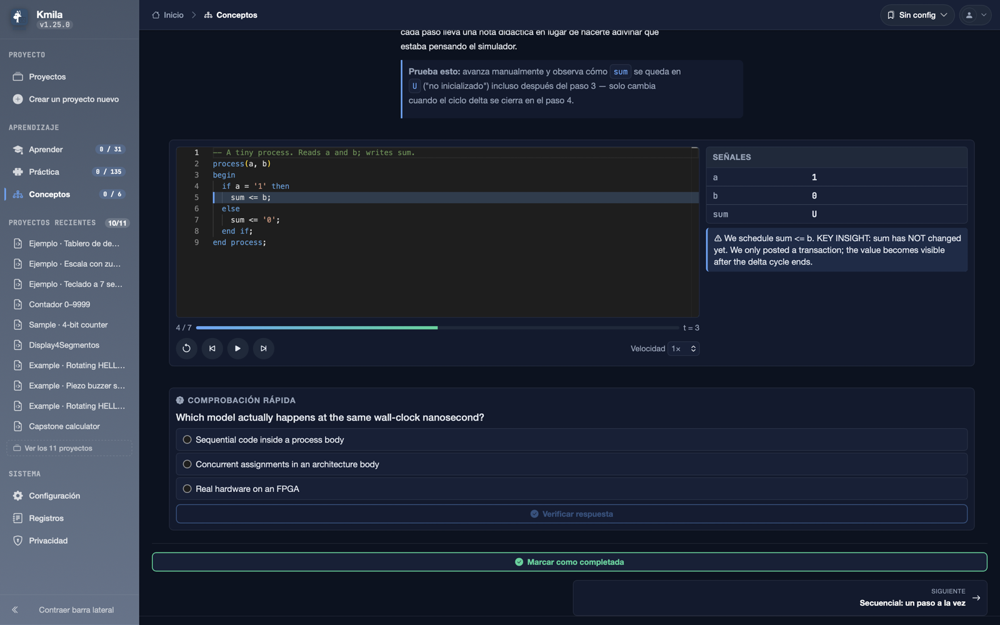 Lecciones de conceptos</td><td align="center">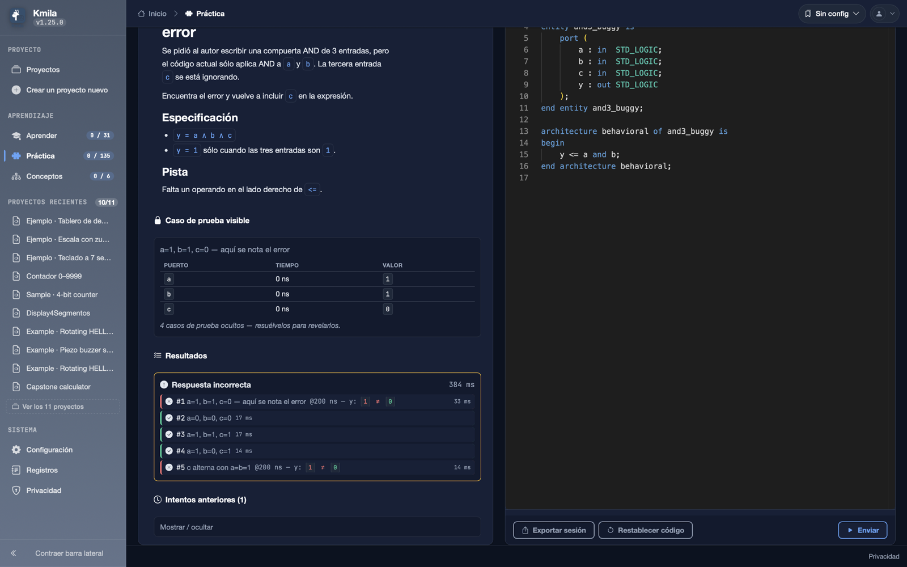 Prácticas autocalificadas</td></tr></table>

### Repositorios

| | | |
|---|---|---|
| 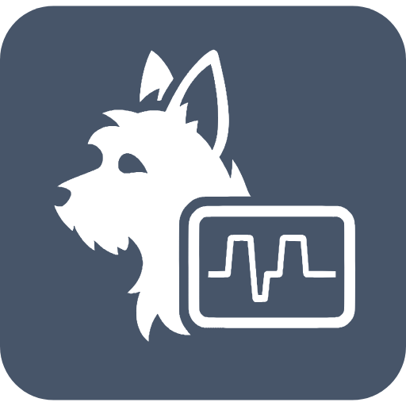 | [**Kmila**](https://github.com/Kmila9s/Kmila) | Escribe, simula y depura HDL sin FPGA |
| 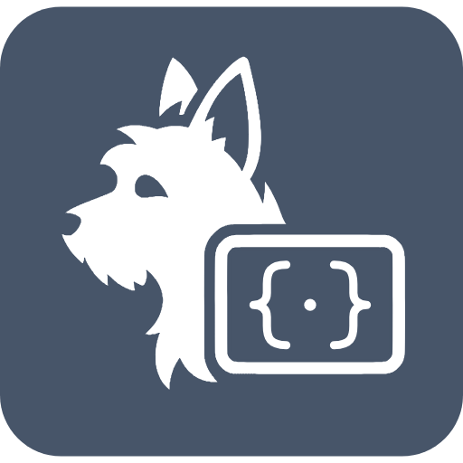 | [**Parser**](https://github.com/Kmila9s/Parser) | Analizador léxico y sintáctico de VHDL para Kmila |
| 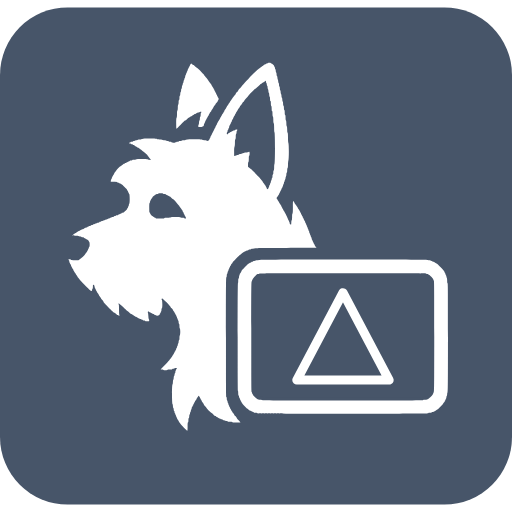 | [**Interpreter**](https://github.com/Kmila9s/Interpreter) | Motor de simulación por ciclos delta y síntesis |
|  | [**Debugger**](https://github.com/Kmila9s/Debugger) | Validación estructural y lint de diseños VHDL |
| 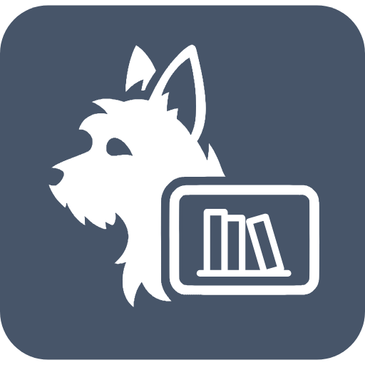 | [**LibraryCompiler**](https://github.com/Kmila9s/LibraryCompiler) | Librerías IEEE, cláusulas use y primitivas |
| 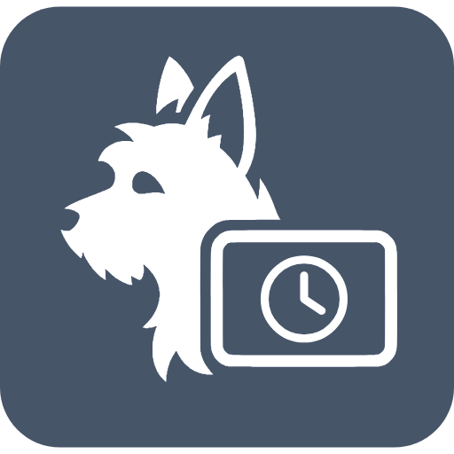 | [**TimeMachine**](https://github.com/Kmila9s/TimeMachine) | Base de tiempo discreta: ticks, relojes y eventos |
| 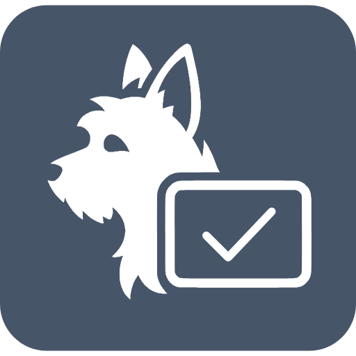 | [**PracticeValidator**](https://github.com/Kmila9s/PracticeValidator) | Valida cada práctica contra GHDL |
| 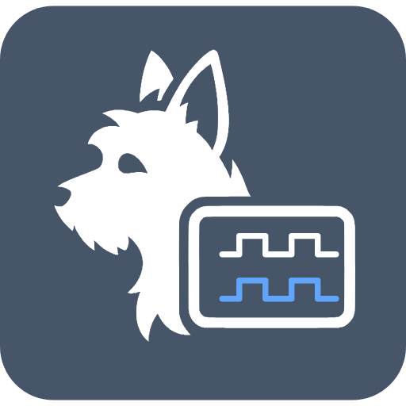 | [**SimulatorBench**](https://github.com/Kmila9s/SimulatorBench) | Banco de exactitud Kmila contra GHDL |
| 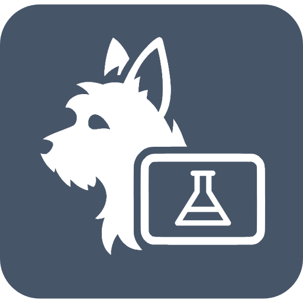 | [**Tests**](https://github.com/Kmila9s/Tests) | Pruebas unitarias, de extremo a extremo y de rendimiento |
| 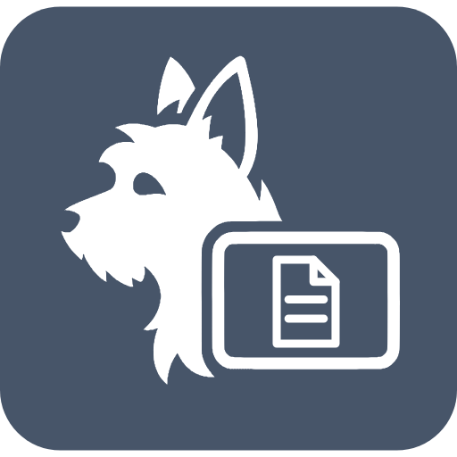 | [**Documentation**](https://github.com/Kmila9s/Documentation/releases) | Tesis y manual de usuario (PDF) |

### Cómo está hecho

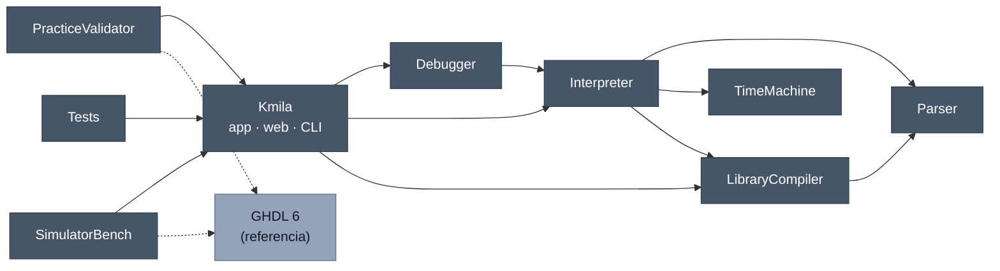

MIT © 2026 Ulrich Tamayo Daniel.  · Desarrollado como Trabajo Terminal TT 2026-B059 en el IPN ESCOM (México).
