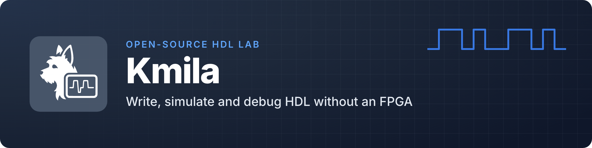
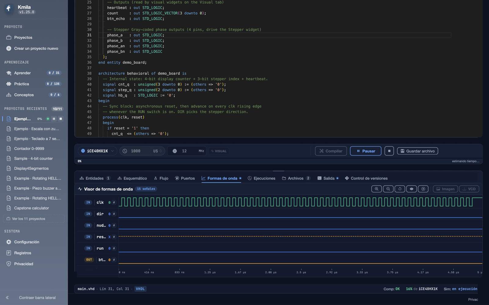
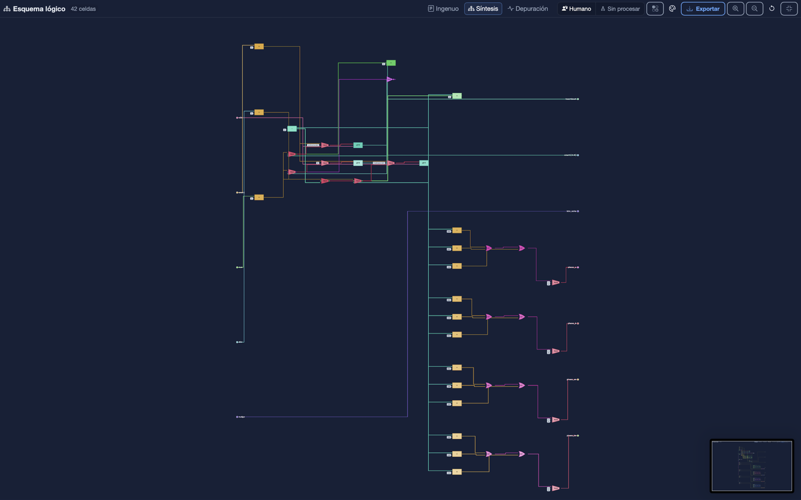
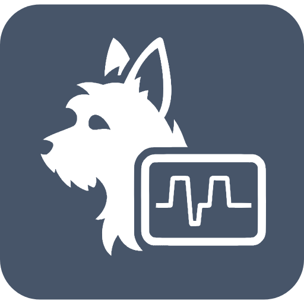
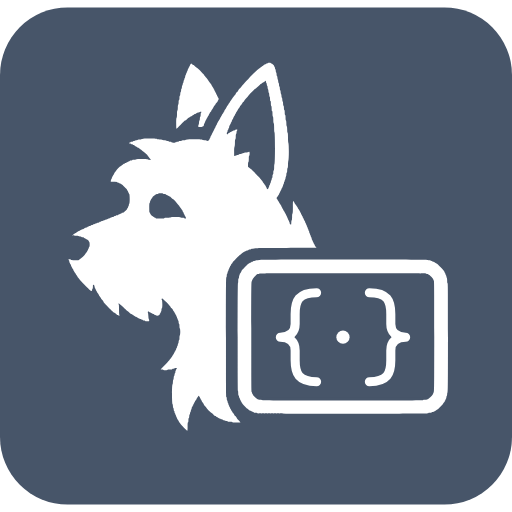
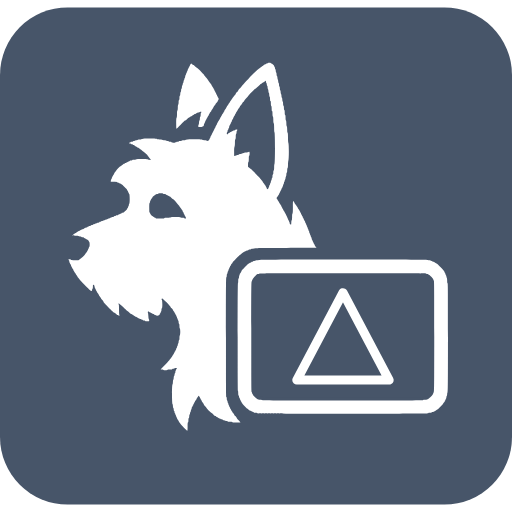
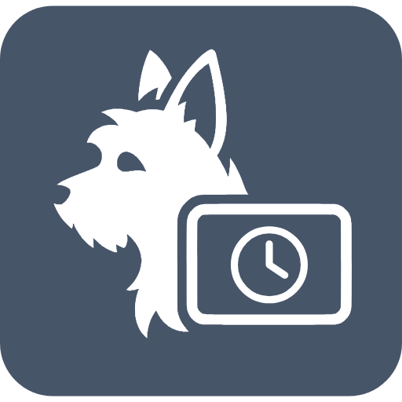
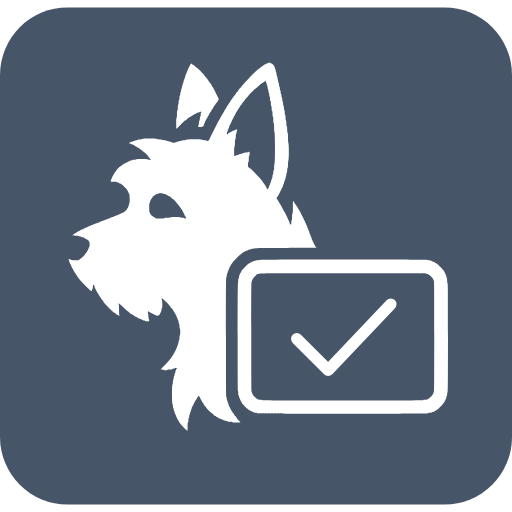
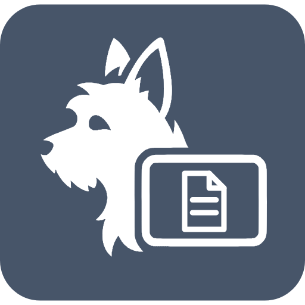
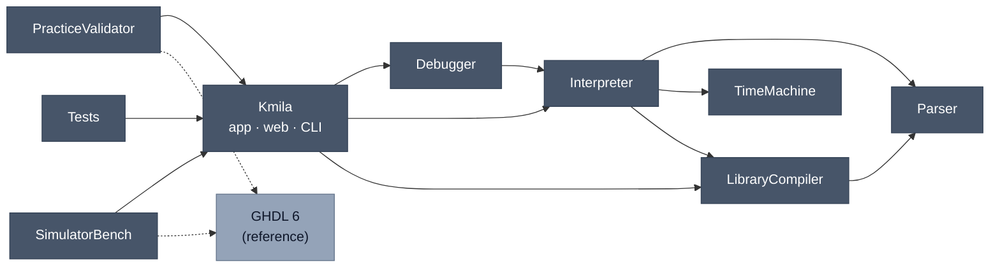

<a href="README.es.md">Español</a>

  <a href="https://kmila.com.mx/demo"><b>Try the browser demo</b></a> · <a href="https://kmila.com.mx">Website</a> · <a href="https://github.com/Kmila9s/Documentation/releases">User manual (PDF) and thesis</a>

**Kmila** is an open-source lab to learn and debug hardware description languages without an FPGA: write VHDL, simulate it, and see waveforms, the synthesized schematic, step-by-step replay and an interactive board, plus lessons and auto-graded practice. Its simulator is checked case by case against GHDL.

<table><tr><td align="center"> Editor and waveforms</td><td align="center"> Synthesized schematic</td></tr><tr><td align="center"> Concept lessons</td><td align="center"> Auto-graded practice</td></tr></table>

### Repositories

| | | |
|---|---|---|
|  | [**Kmila**](https://github.com/Kmila9s/Kmila) | Write, simulate and debug HDL without an FPGA |
|  | [**Parser**](https://github.com/Kmila9s/Parser) | VHDL lexer and front-door parsing for Kmila |
|  | [**Interpreter**](https://github.com/Kmila9s/Interpreter) | Delta-cycle HDL simulation engine and synthesis |
|  | [**Debugger**](https://github.com/Kmila9s/Debugger) | Structural checks and lint for VHDL designs |
|  | [**LibraryCompiler**](https://github.com/Kmila9s/LibraryCompiler) | IEEE libraries, use clauses and primitive lowering |
|  | [**TimeMachine**](https://github.com/Kmila9s/TimeMachine) | Discrete time base: ticks, clocks and events |
|  | [**PracticeValidator**](https://github.com/Kmila9s/PracticeValidator) | Validates every practice against GHDL |
|  | [**SimulatorBench**](https://github.com/Kmila9s/SimulatorBench) | Kmila vs GHDL accuracy bench |
|  | [**Tests**](https://github.com/Kmila9s/Tests) | Unit, end-to-end and performance suites |
|  | [**Documentation**](https://github.com/Kmila9s/Documentation/releases) | Thesis and user manual (PDF) |

### How it is built

MIT © 2026 Ulrich Tamayo Daniel.  · Developed as the degree project TT 2026-B059 at IPN ESCOM (Mexico).
